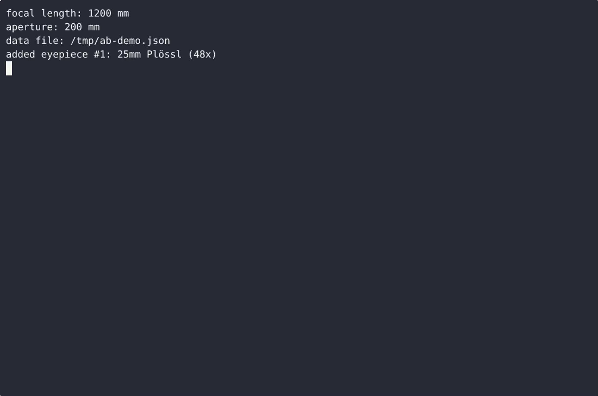
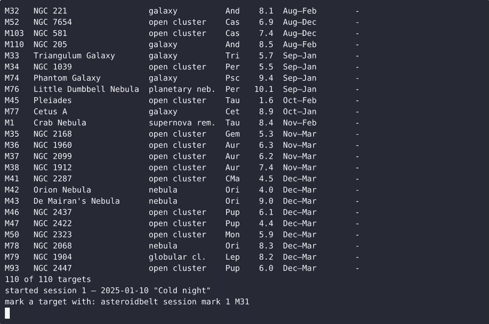

# AsteroidBelt — complete Full-stack app command-line tool example app

If you want a self-hosted command-line tool without the vendor lock-in, **AsteroidBelt** is ready to run. Built with Full-stack app and Apache-2.0-licensed, AsteroidBelt ships complete — one clone, one install command. AsteroidBelt is a single-file, standard-library-only Python command-line tool for a visual observer: it turns the telescope focal length stored in its config plus your eyepiece focal lengths into magnification, exit p…. [Open AsteroidBelt on cenius.ai](https://cenius.ai/marketplace/p/asteroidbelt?ref=gh&utm_campaign=asteroidbelt-webapp) to customise it without touching a line of AsteroidBelt code.


[](LICENSE)  [](https://cenius.ai)

[](https://cenius.ai/marketplace/p/asteroidbelt?ref=gh&utm_campaign=asteroidbelt-webapp)

> **▶ [Open & edit in cenius.ai](https://cenius.ai/marketplace/p/asteroidbelt?ref=gh&utm_campaign=asteroidbelt-webapp)** — one click to an editable workspace: describe changes in plain English, get an instant preview, one-click deploy and host. Modifications made on the platform come with full rebrand & relicense rights.

_Local clone? See [Quick start](#quick-start) below. cenius.ai is the zero-setup path._

## Demo


📽 **[Demo video on cenius.ai](https://cenius.ai/marketplace/p/asteroidbelt?ref=gh&utm_campaign=asteroidbelt-webapp)** — the complete run-through · [MP4](.github/media/demo.mp4)

## Screenshots

 

## Quick start

```bash
./install.sh   # installs dependencies + seeds demo data
```

See [`INSTALL.md`](INSTALL.md) for full setup and usage instructions.

## Features

- Eyepiece magnification library
- Messier best-month viewing windows
- Observing sessions with mark-off targets
- Telescope profile config

## Architecture

The repository contains 14 files of Full-stack app source, organised under `docs/`, `tests/`. `install.sh` provisions dependencies and seeds demo data so the app starts with something real to explore. Installation walkthrough: [`INSTALL.md`](INSTALL.md).

## Usage guide

### Overview

Eyepiece magnifications, Messier viewing windows and per-session target mark-off

### Quickstart

```bash
asteroidbelt --help
## or, if installed from source without symlink:
python -m asteroidbelt --help
```

### Commands

This CLI exposes **12** subcommands. Each was extracted from the source.

| Command | Source file |
|---------|-------------|
| `asteroidbelt add` | `asteroidbelt.py` |
| `asteroidbelt config` | `asteroidbelt.py` |
| `asteroidbelt eyepieces` | `asteroidbelt.py` |
| `asteroidbelt list` | `asteroidbelt.py` |
| `asteroidbelt mark` | `asteroidbelt.py` |
| `asteroidbelt remove` | `asteroidbelt.py` |
| `asteroidbelt session` | `asteroidbelt.py` |
| `asteroidbelt set` | `asteroidbelt.py` |
| `asteroidbelt show` | `asteroidbelt.py` |
| `asteroidbelt start` | `asteroidbelt.py` |
| `asteroidbelt targets` | `asteroidbelt.py` |
| `asteroidbelt unmark` | `asteroidbelt.py` |

#### Per-command help

```bash
asteroidbelt --help                # top-level help
asteroidbelt add --help    # help for `add`
```

### Worked example

1. Verify the CLI is on your PATH: `which asteroidbelt` (or run via `cargo run --`/`python -m`).
2. Show all subcommands: `asteroidbelt --help`.
3. Try the first detected subcommand:

```bash
asteroidbelt add --help
```

### Reference

#### Entry points

| Kind | Name | Source |
|------|------|--------|
| Console script | `asteroidbelt` | `asteroidbelt:main` (pyproject.toml) |

#### Surface index (auto-extracted)

_Full guide: [`USAGE.md`](USAGE.md)_

## FAQ

### What's the quickest way to self-host AsteroidBelt?

Everything you need ships in this repo: clone it, run `./install.sh` to install dependencies and seed demo data, then follow [`INSTALL.md`](INSTALL.md) to start it. No external services required.

### How can I customize AsteroidBelt without editing code?

Open it on [cenius.ai](https://cenius.ai/marketplace/p/asteroidbelt?ref=gh&utm_campaign=asteroidbelt-webapp) and describe the changes you want in plain English — the platform modifies the app and gives you a new, downloadable build.

### How is AsteroidBelt built technically?

Full-stack app. The full source in this repository is exactly what the app runs. Highlights include observing sessions with mark-off targets.

### Can I build a business on AsteroidBelt?

Confirmed free for commercial use — MIT terms let you incorporate, resell, or ship it in any product. [LICENSE](LICENSE).

### Can I remove the AsteroidBelt name and use my own?

Yes. The MIT license lets you remove the original branding and ship under your own name. For a guided approach, [remix it on cenius.ai](https://cenius.ai/marketplace/p/asteroidbelt?ref=gh&utm_campaign=asteroidbelt-webapp): you get a fresh build with full rebrand and relicense rights.

## License & rebranding

Released under the [Apache License 2.0](LICENSE) (© 2026 Cenius AI) — free for personal and commercial use. The Cenius name/logo are trademarks (see NOTICE).

**Need a customized version?** [Remix this app on cenius.ai](https://cenius.ai/marketplace/p/asteroidbelt?ref=gh&utm_campaign=asteroidbelt-webapp) — modifications made on the platform come with **full rebrand & relicense rights** over your derivative.

## Built with cenius.ai

This entire application — code, design, seeded demo data — was generated on **[cenius.ai](https://cenius.ai)** from a plain-English description.

- 🚀 [Build your own app on cenius.ai](https://cenius.ai)
- 🎛️ [Remix AsteroidBelt on the marketplace](https://cenius.ai/marketplace/p/asteroidbelt?ref=gh&utm_campaign=asteroidbelt-webapp) — open it in a workspace, prompt for changes, and ship your own version.

More open-source apps: [the Cenius-ai catalog](https://github.com/Cenius-ai) · [showcase index](https://github.com/Cenius-ai/showcase)
